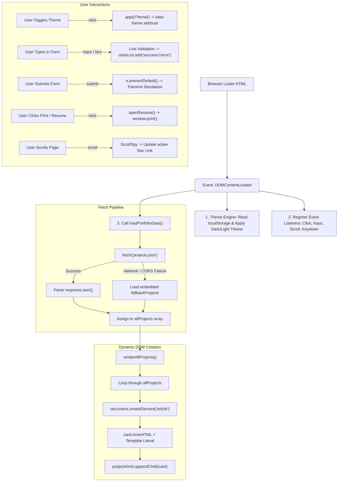

# JavaScript Architecture & Mechanics Explained
### Complete Guide to Event Listeners, Fetch API, and Dynamic DOM Manipulation in `e-portfolio`

---

## 1. Executive Overview

This portfolio application (`e-portfolio`) is driven by vanilla JavaScript in [script.js](file:///c:/Users/Ayush/Desktop/Python/Javascript/e-portfolio/script.js). It adheres to modern ECMAScript standards without any third-party framework overhead.

The script operates around **three core pillars**:
1. **Event-Driven Architecture (`addEventListener`)**: Reacting asynchronously to user actions (clicks, keystrokes, form submissions, focus changes, and window scrolling).
2. **Asynchronous Network Pipeline (`fetch` & `async/await`)**: Decoupling the portfolio dataset into [projects.json](file:///c:/Users/Ayush/Desktop/Python/Javascript/e-portfolio/projects.json) and fetching it at runtime with a resilient zero-fail fallback.
3. **Dynamic DOM Manipulation (`createElement`, `appendChild`, `innerHTML`)**: Generating styled HTML cards in memory and appending them to the document tree dynamically.



---

## 2. Event Listeners (`addEventListener`)

### What is an Event Listener?
In JavaScript, an **event listener** is a function that waits for a specific event (such as a mouse click, keypress, or data arrival) to occur on a specified DOM element.

**Syntax:**
```javascript
targetElement.addEventListener(eventType, callbackFunction, options);
```
- **`targetElement`**: The DOM node being monitored (e.g., `document`, `window`, a `<button>`, an `<input>`).
- **`eventType`**: A string indicating the event name (e.g., `'click'`, `'input'`, `'DOMContentLoaded'`).
- **`callbackFunction`**: The function executed immediately when the event triggers.

---

### Inventory of All Event Listeners in `script.js`

| Line(s) | Target Element | Event Type | Purpose & Mechanism |
| :--- | :--- | :--- | :--- |
| **Line 9** | `document` | `'DOMContentLoaded'` | Waits until HTML parsing finishes before executing any JS logic. |
| **Line 59** | `#btn-dark`, `#btn-light` | `'click'` | Switches between Emerald Dark (`#0D1714`) and Light (`#F5F7F3`) themes. |
| **Line 72** | `#mobile-toggle` | `'click'` | Opens and closes the mobile slide-down menu. |
| **Line 79** | `.nav-link` (each link) | `'click'` | Closes mobile menu automatically when a navigation link is clicked. |
| **Line 261** | `.open-resume-btn` (all) | `'click'` | Opens the official resume modal dialog (`#resume-modal`). |
| **Line 268** | `.print-resume-btn` (all) | `'click'` | Mounts resume modal and launches the native `window.print()` dialog. |
| **Line 274** | `#resume-modal-close` | `'click'` | Closes the resume modal via top corner '×' button. |
| **Line 275** | `#resume-dismiss-btn` | `'click'` | Closes the resume modal via footer 'Close' button. |
| **Line 277** | `#resume-modal` | `'click'` | Closes modal when user clicks on the backdrop outside the modal card. |
| **Line 283** | `document` | `'keydown'` | Global keyboard handler: closes modal when user presses <kbd>Escape</kbd>. |
| **Line 358, 362** | `#contact-name` | `'input'`, `'blur'` | Validates name live on typing and when leaving the input field. |
| **Line 366, 370** | `#contact-email` | `'input'`, `'blur'` | Validates email address syntax against regex on typing and on blur. |
| **Line 374, 375** | `#contact-subject` | `'change'`, `'blur'` | Validates category selection upon dropdown change or exit. |
| **Line 379, 388** | `#contact-message` | `'input'`, `'blur'` | Live character counter (`X / 500`) and minimum length check (15 chars). |
| **Line 393** | `#contact-form` | `'submit'` | Intercepts submission with `e.preventDefault()`, validates, and dispatches. |
| **Line 445** | `#contact-form` | `'reset'` | Resets all validation classes and character counters when cleared. |
| **Line 462** | `window` | `'scroll'` | Calculates scroll position and sets `.active` on current section's nav link. |
| **Lines 489–532** | `#portrait-frame` | `'mouseenter'`, `'mousemove'`, `'mouseleave'`, `'click'`, `'keydown'` | **Dynamic 3D Perspective Tilt**: Tracks cursor across portrait, tilts frame up to 7.5°, follows specular light reflection, and opens modal on click/Enter. |

---

### In-Depth Breakdown of Key Event Listeners

#### 1. DOM Readiness (`DOMContentLoaded`)
```javascript
// script.js, Line 9
document.addEventListener('DOMContentLoaded', () => {
    'use strict';
    // All initialization code lives inside here
});
```
- **Why this is needed:** If JavaScript runs before the browser has finished reading the HTML, calls like `document.getElementById('projects-grid')` will return `null` and crash.
- **How it works:** The browser fires `'DOMContentLoaded'` as soon as the HTML Document Object Model is completely built and ready to be queried, without waiting for large images or stylesheets to finish loading.

---

#### 2. Theme Switcher Click Listener
```javascript
// script.js, Lines 56-63
Object.entries(themeButtons).forEach(([key, btn]) => {
    if (btn) {
        btn.addEventListener('click', () => {
            applyTheme(key);
        });
    }
});
```
- **How it works:**
  1. We store references to `#btn-dark` and `#btn-light` in an object: `{ dark: el, light: el }`.
  2. `Object.entries()` loops over both buttons.
  3. When the user clicks `#btn-light`, `applyTheme('light')` executes:
     - Updates `<html data-theme="light">` via `document.documentElement.setAttribute('data-theme', 'light')`.
     - Writes `'light'` into browser `localStorage.setItem('preferredTheme', 'light')` for persistence across page reloads.
     - Adds `.active` and `aria-pressed="true"` to the selected button and removes it from the other.

---

#### 3. Modal Backdrop Click & Keyboard Listeners
```javascript
// script.js, Lines 276-287
if (resumeModal) {
    resumeModal.addEventListener('click', (e) => {
        // e.target is the element that received the click
        if (e.target === resumeModal) closeResume();
    });
}

document.addEventListener('keydown', (e) => {
    if (e.key === 'Escape') {
        closeResume();
    }
});
```
- **Event Delegation & Target Checking (`e.target === resumeModal`):**
  The modal dialog consists of an outer overlay (`.modal-overlay`) and an inner card (`.modal-dialog`). If the user clicks inside the dialog text or buttons, `e.target` is the inner content, so it does **not** close. If the user clicks the dark background outside the card, `e.target === resumeModal` evaluates to `true`, cleanly closing the modal.
- **Keyboard Listener:** Listening on `document` for `'keydown'` allows anyone using accessibility or keyboard navigation to dismiss the modal instantly with <kbd>Esc</kbd>.

---

#### 4. Live Form Input & Blur Listeners
```javascript
// script.js, Lines 357-363
if (nameInput) {
    nameInput.addEventListener('input', () => {
        if (nameInput.value.length > 0) validateName();
        else clearFieldState(document.getElementById('group-name'));
    });
    nameInput.addEventListener('blur', validateName);
}
```
- **The difference between `'input'` and `'blur'`:**
  - **`'input'`:** Triggers on **every single keystroke** or text paste. We use this to provide instantaneous live feedback (e.g. updating the character counter `38 / 500`).
  - **`'blur'`:** Triggers when an input **loses focus** (i.e. the user tabs to the next field or clicks away). If the user leaves the field empty, `'blur'` immediately flags the field with a red border and validation message.

---

#### 5. Form Submission Interception (`e.preventDefault()`)
```javascript
// script.js, Lines 392-410
contactForm.addEventListener('submit', (e) => {
    e.preventDefault(); // <-- STOPS native browser page reload!

    const isNameValid = validateName();
    const isEmailValid = validateEmail();
    const isSubjectValid = validateSubject();
    const isMessageValid = validateMessage();

    if (!isNameValid || !isEmailValid || !isSubjectValid || !isMessageValid) {
        // Show validation error banner
        return;
    }
    
    // Simulate async transmission
});
```
- **Why `e.preventDefault()` is essential:** By default, HTML forms submit via a standard HTTP POST/GET request that refreshes or navigates away from the page. Calling `e.preventDefault()` suppresses that browser behavior, allowing JavaScript to validate inputs, display inline spinner states ("Transmitting..."), and show success feedback without a page reload.

---

#### 6. Scroll Position Spy Listener
```javascript
// script.js, Lines 462-480
window.addEventListener('scroll', () => {
    let currentSectionId = '';
    const scrollPosition = window.scrollY + 120; // 120px offset for sticky header

    sections.forEach(section => {
        const sectionTop = section.offsetTop;
        const sectionHeight = section.offsetHeight;
        if (scrollPosition >= sectionTop && scrollPosition < sectionTop + sectionHeight) {
            currentSectionId = section.getAttribute('id');
        }
    });

    navLinks.forEach(link => {
        link.classList.remove('active');
        if (link.getAttribute('href') === `#${currentSectionId}`) {
            link.classList.add('active'); // Highlights current section in header
        }
    });
});
```
- **How it works:** Whenever the user scrolls, JavaScript compares `window.scrollY` against the top and bottom pixel coordinates of each `<section>`. When it finds the section currently in view, it updates the corresponding header link with the `.active` class (rendering it in Emerald Green `#36A878`).

---

## 3. The Fetch API (`fetch` & `async/await`)

### What is `fetch()`?
The **Fetch API** provides a JavaScript interface for accessing and manipulating HTTP pipeline requests and responses. It returns a **Promise** that resolves to the `Response` object representing the response to the request.

---

### How `fetch` is Implemented in `script.js`
The fetch logic is encapsulated in `loadPortfolioData()`:

```javascript
// script.js, Lines 213-227
async function loadPortfolioData() {
    try {
        const response = await fetch('projects.json');
        
        if (!response.ok) {
            throw new Error(`HTTP Error: ${response.status}`);
        }
        
        const data = await response.json();
        allProjects = Array.isArray(data) && data.length > 0 ? data : fallbackProjects;
        
    } catch (err) {
        console.info('Using fallback project dataset:', err.message);
        allProjects = fallbackProjects;
    } finally {
        renderAllProjects();
    }
}
```

---

### Step-by-Step Execution of the Fetch Pipeline

```
[1. fetch('projects.json')] 
          │
          ▼
[2. HTTP Status Check: response.ok?]
     ├── YES (200 OK) ──► [3. response.json()] ──► [4. Assign to allProjects]
     └── NO (404/500)  ──► [Throw Error]       ──┐
                                                 │
[Network / CORS Error (e.g. file://)] ───────────┼──► [5. Catch: Assign fallbackProjects]
                                                 │
                                                 ▼
                                     [6. Finally: renderAllProjects()]
```

1. **`async function` & `await`:**
   Declaring the function as `async` allows using the `await` keyword. This pauses execution at that line until the network promise resolves, avoiding messy `.then()` callback pyramids.
2. **`fetch('projects.json')`:**
   Sends an asynchronous HTTP GET request to retrieve [projects.json](file:///c:/Users/Ayush/Desktop/Python/Javascript/e-portfolio/projects.json) from the server.
3. **`response.ok` Verification:**
   A fetch promise does **not** reject on HTTP errors like 404 (Not Found) or 500 (Internal Server Error). It only rejects on total network failure or CORS blocking. Checking `if (!response.ok)` ensures we only parse real, successful responses.
4. **`await response.json()`:**
   Reads the incoming HTTP response body stream to completion and parses the raw text as JSON into a native JavaScript Array.
5. **Fail-Safe Fallback (`catch` block & `fallbackProjects`):**
   If a user opens the portfolio by double-clicking `index.html` (the `file://` protocol), browser security restrictions (CORS) block local `fetch()` requests.
   Instead of displaying a blank screen or broken UI, our `catch` block catches the error and assigns `allProjects = fallbackProjects` (an embedded copy defined on line 90).
6. **`finally { renderAllProjects(); }`:**
   Regardless of whether the data arrived via HTTP network fetch or fallback, `finally` guarantees that `renderAllProjects()` is always called to draw the cards on screen.

---

## 4. Dynamic DOM Manipulation ("Add", `createElement`, `appendChild`)

### Where and How Elements are Created and Added
All project cards are dynamically injected into the empty `<div id="projects-grid"></div>` container located in `index.html`.

Here is the complete rendering function:

```javascript
// script.js, Lines 169-208
function renderAllProjects() {
    if (!projectsGrid) return;
    
    // Step 1: Wipe any previous elements or loading states
    projectsGrid.innerHTML = '';

    // Step 2: Iterate over every project object
    allProjects.forEach((project, index) => {
        
        // Step 3: Create a brand new DOM element node in memory
        const card = document.createElement('article');
        
        // Step 4: Add CSS class and inline styles
        card.className = 'project-card';
        card.style.animationDelay = `${index * 0.08}s`;

        // Step 5: Build dynamic inner tags HTML using Array.prototype.map()
        const tagsHtml = project.tags
            .map(tag => `<span class="tech-tag">${tag}</span>`)
            .join('');

        // Step 6: Inject structured markup via Template Literal
        card.innerHTML = `
            <div class="project-card-header">
                <span class="project-cat-pill">${project.categoryLabel}</span>
                <span class="project-badge-pill">${project.badge || project.period}</span>
            </div>

            <h3 class="project-title">${project.title}</h3>
            <div class="project-subtitle">${project.subtitle}</div>
            <p class="project-description">${project.description}</p>

            <div class="project-metrics-banner">${project.metrics}</div>

            <div class="project-tags-row">
                ${tagsHtml}
            </div>

            ${project.github ? `
                <div class="project-card-actions">
                    <a href="${project.github}" target="_blank" rel="noopener noreferrer" class="btn btn-outline btn-sm">
                        <span>View Repository</span>
                    </a>
                </div>
            ` : ''}
        `;

        // Step 7: APPEND the finished node into the live DOM tree
        projectsGrid.appendChild(card);
    });
}
```

---

### The DOM Operations Explained

| Method / Property | What It Does in Our Code |
| :--- | :--- |
| **`projectsGrid.innerHTML = '';`** | Clears the container before rendering. Prevents duplicating cards if re-rendered. |
| **`document.createElement('article')`** | Creates an unattached `<article>` HTML element in memory. Using semantic `<article>` instead of `<div>` enhances screen-reader accessibility and SEO. |
| **`card.className = 'project-card'`** | Assigns the CSS styling class defined in [style.css](file:///c:/Users/Ayush/Desktop/Python/Javascript/e-portfolio/style.css), applying the charcoal background (`#17231E`), subtle borders (`#34473E`), and hover animations. |
| **`card.style.animationDelay = ...`** | Staggers the entrance fade-in animation of each card (`0.00s`, `0.08s`, `0.16s`, `0.24s`), creating a high-end AI research laboratory visual feel. |
| **`project.tags.map().join('')`** | Takes an array of strings (e.g. `["TensorFlow", "6G/mmWave"]`) and transforms each string into a `<span class="tech-tag">` pill. |
| **`card.innerHTML = \`...\``** | Fills the internal HTML structure using ES6 Template Literals. Supports conditional rendering (e.g. only rendering the GitHub button if `project.github` exists). |
| **`projectsGrid.appendChild(card)`** | Inserts the completed `card` node as the last child of `#projects-grid`. This is the exact moment the element becomes visible in the browser window. |

---

## 5. Adding & Removing Classes / Attributes (`classList` & `setAttribute`)

Beyond creating elements, JavaScript constantly manages state by **adding**, **removing**, and **toggling** classes and attributes:

### 1. `classList.add()`, `classList.remove()`, and `classList.toggle()`
```javascript
// Adding and removing validation feedback (script.js, Lines 340-349)
function setFieldState(groupElement, isValid) {
    if (isValid) {
        groupElement.classList.add('success');   // Shows green border & checkmark icon
        groupElement.classList.remove('error');
    } else {
        groupElement.classList.add('error');     // Shows red border & error message
        groupElement.classList.remove('success');
    }
}

// Toggling mobile navigation drawer (script.js, Line 73)
const isOpen = navMenu.classList.toggle('open');
```

### 2. `setAttribute()` and `getAttribute()`
```javascript
// Theme engine: sets <html data-theme="dark"> or <html data-theme="light">
document.documentElement.setAttribute('data-theme', validTheme);

// Screen-reader accessibility toggles
mobileToggle.setAttribute('aria-expanded', isOpen.toString());
resumeModal.setAttribute('aria-hidden', 'false');
btn.setAttribute('aria-pressed', 'true');
```

---

## 6. Summary Quick Reference Cheatsheet

| Concept | Code Location in `script.js` | How to Identify | What it Achieves |
| :--- | :--- | :--- | :--- |
| **Page Initialization** | Line 9 | `document.addEventListener('DOMContentLoaded', ...)` | Starts JS execution safely after DOM tree is parsed. |
| **Theme Toggle** | Lines 15–63 | `btn.addEventListener('click', ...)` + `applyTheme()` | Toggles between Dark Graphite & Light Mint themes. |
| **Mobile Drawer** | Lines 68–84 | `mobileToggle.addEventListener('click', ...)` | Toggles `.open` class and updates `aria-expanded`. |
| **Fetch Request** | Line 215 | `const response = await fetch('projects.json')` | Requests projects dataset asynchronously via HTTP. |
| **Network Fallback** | Line 223 | `catch (err) { allProjects = fallbackProjects; }` | Ensures zero-failure even under local `file://` protocol. |
| **Create Element** | Line 174 | `const card = document.createElement('article')` | Instantiates a new card node in memory. |
| **Append Element** | Line 206 | `projectsGrid.appendChild(card)` | Mounts the card node into the visible HTML layout. |
| **Print Trigger** | Line 256 | `window.print()` | Opens browser print/save-as-PDF dialog. |
| **Live Keystroke Listener** | Lines 358, 366, 379 | `input.addEventListener('input', ...)` | Runs instant validation and live character counter. |
| **Field Exit Listener** | Lines 362, 370, 388 | `input.addEventListener('blur', ...)` | Validates field when user leaves focus. |
| **Form Submit Intercept** | Line 393 | `form.addEventListener('submit', (e) => e.preventDefault())` | Blocks page refresh, validates inputs, simulates dispatch. |
| **ScrollSpy** | Line 462 | `window.addEventListener('scroll', ...)` | Dynamically highlights active navigation item on scroll. |

---

*Authored for the Ayush Sunil Bisen Engineering & Research E-Portfolio codebase.*
